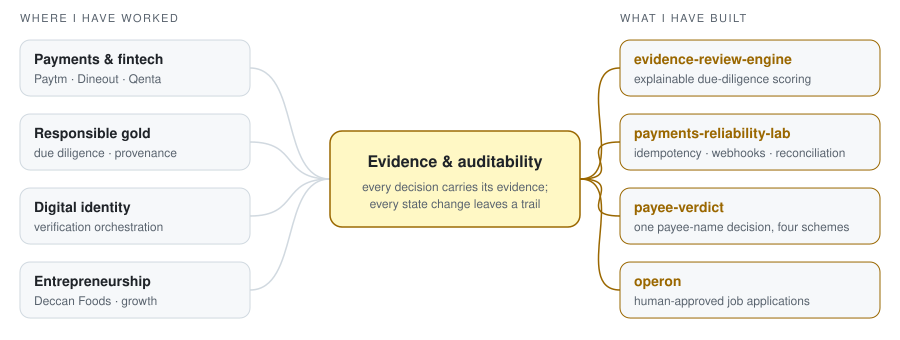

**Product leader in payments and responsible-gold due diligence, who also builds the systems.**
I turn high-trust business processes into software where every decision carries its evidence and every state change leaves an audit trail.

Principal Product Manager at **Qenta** · previously product at **Paytm** and **Dineout** · co-founder and brand strategist, **Deccan Foods** · MBA, **Rice Business** (2024)

<picture>
  <source media="(prefers-color-scheme: dark)" srcset="assets/domain-map-dark.svg">
  <source media="(prefers-color-scheme: light)" srcset="assets/domain-map-light.svg">
  
</picture>

---

## What I've built, and how to check it

| Project | The problem | What you can verify in 3 minutes | Stack |
|---|---|---|---|
| [**evidence-review-engine**](https://github.com/karthy1004/evidence-review-engine) | Supply-chain due diligence where suppliers answer "yes" to everything | `python -m evidence_review demo`: a supplier with 12 "yes" answers scores 16/100 because its documents are expired, stale or issued to another company. 59 tests. An eval harness whose headline metric is *silent errors*. | Python · Pydantic · Claude API (optional) |
| [**payments-reliability-lab**](https://github.com/karthy1004/payments-reliability-lab) | Payments that stay correct when the provider times out, webhooks repeat and clients double-click | `npm run demo`: one charge despite retries, a timed-out payment settled by webhook, a forged webhook rejected, and reconciliation catching an amount break. 59 tests. | TypeScript · Node 24 · Fastify · SQLite |
| [**payee-verdict**](https://github.com/karthy1004/payee-verdict) | Payout platforms face four different payee-name checks (EU VoP, UK CoP, India, PIX) and need one defensible decision | `python -m payee_verdict demo`: "Müller GmbH" matches "MUELLER GMBH" with a full trace, a fraud-flagged PIX key is held, tampering with the evidence log is detected. 143 tests. A 181-case test set: 96.1%, zero false matches. | Python · Pydantic |
| [**operon**](https://github.com/karthy1004/operon) | Job applications done for the candidate, with the candidate keeping a veto | Domain model for the full service lifecycle, Stripe test-mode checkout with exactly-once webhooks, approval engine with compare-and-set transitions. **Prototype, not launched.** | Next.js 16 · Prisma · Clerk · Stripe |

All four are clean-room builds with synthetic data. None contains employer code, data or methodology.

## How I work

- **Claims need evidence.** In my due-diligence engine, an unbacked "yes" scores zero. My [skills matrix](docs/skills-evidence-matrix.md) applies the same rule to me.
- **Design the failure path first.** A payment timeout means *unknown*, not *failed*. Getting that wrong is how customers are charged twice. [ADR-1](https://github.com/karthy1004/payments-reliability-lab/blob/main/docs/decisions.md)
- **AI only where it can be measured against a baseline.** The LLM step must pass schema, consistency and grounding checks, and it is scored against a regex baseline on silent errors, not accuracy. [Eval results](https://github.com/karthy1004/evidence-review-engine/blob/main/evals/results/baseline.md)
- **Write decisions down.** Every repo has ADRs recording what was chosen, what was rejected, and what it costs. [Example](https://github.com/karthy1004/operon/blob/main/docs/adr/0001-collapsed-self-serve-funnel.md)

## Background

My background spans building a food brand as a co-founder (Deccan Foods), consumer payments at Paytm, and restaurant payments and merchant acquisition at Dineout. At Qenta I lead the Responsible Gold due-diligence product and contribute product strategy across its payments, G-Coin (digitised gold) and QID (decentralised identity) work. The common thread is trust between parties who don't know each other. These days I build the systems myself, as well as specifying them.

## Next *(as of October 2026)*

Run the live-model evaluation for `evidence-review-engine` and publish the result, good or bad.

---

No stats widgets on purpose: everything above links to something you can run. Built with Claude Code as an AI pair programmer.
