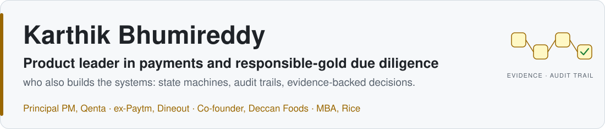
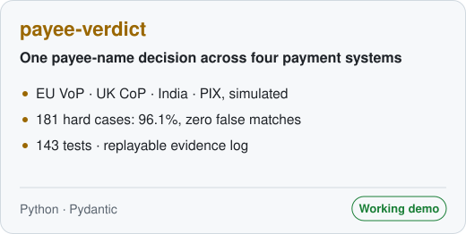
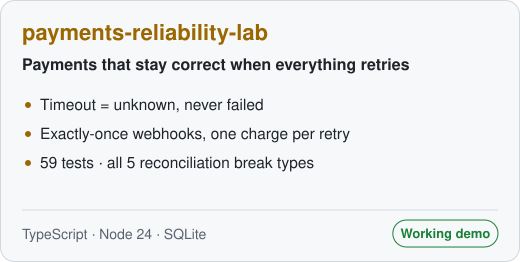
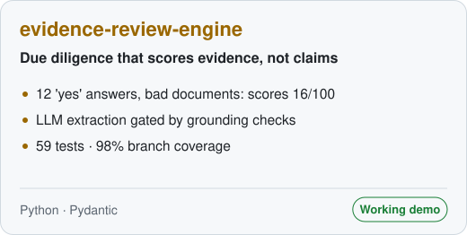
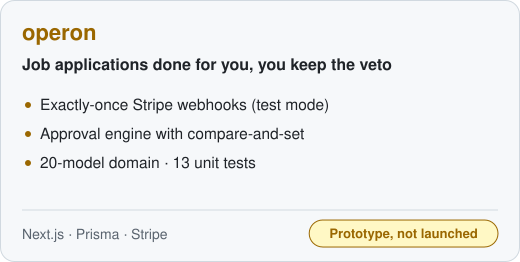

<a href="https://www.linkedin.com/in/karthikbhumireddy">
  <picture>
    <source media="(prefers-color-scheme: dark)" srcset="assets/banner-dark.svg">
    <source media="(prefers-color-scheme: light)" srcset="assets/banner-light.svg">
    
  </picture>
</a>

  <a href="https://www.linkedin.com/in/karthikbhumireddy"><b>LinkedIn</b></a> ·
  <a href="#featured-work"><b>Featured work</b></a> ·
  <a href="docs/skills-evidence-matrix.md"><b>Skills, with evidence</b></a>

I've spent my career on the business side of trust: building a food brand as a co-founder, then payments products at Paytm, Dineout and now Qenta, where I lead the Responsible Gold due-diligence product. The question underneath all of it is the same: **how do two parties who don't know each other trust a transaction?** These repositories are my answers in code. Each one makes a decision and keeps the evidence for it.

## Featured work

<table>
  <tr>
    <td width="50%" valign="top">
      <a href="https://github.com/karthy1004/payee-verdict">
        <picture>
          <source media="(prefers-color-scheme: dark)" srcset="assets/card-payee-verdict-dark.svg">
          
        </picture>
      </a>
        <b>One payout decision across four name-check systems.</b> Zero false matches on 181 hard cases. <code>python -m payee_verdict demo</code>
    </td>
    <td width="50%" valign="top">
      <a href="https://github.com/karthy1004/payments-reliability-lab">
        <picture>
          <source media="(prefers-color-scheme: dark)" srcset="assets/card-payments-reliability-lab-dark.svg">
          
        </picture>
      </a>
        <b>Timeout means unknown, never failed.</b> One charge however often the client retries. <code>npm run demo</code>
    </td>
  </tr>
  <tr>
    <td width="50%" valign="top">
      <a href="https://github.com/karthy1004/evidence-review-engine">
        <picture>
          <source media="(prefers-color-scheme: dark)" srcset="assets/card-evidence-review-engine-dark.svg">
          
        </picture>
      </a>
        <b>Scores evidence, not claims.</b> 12 "yes" answers with bad documents score 16/100. <code>python -m evidence_review demo</code>
    </td>
    <td width="50%" valign="top">
      <a href="https://github.com/karthy1004/operon">
        <picture>
          <source media="(prefers-color-scheme: dark)" srcset="assets/card-operon-dark.svg">
          
        </picture>
      </a>
        <b>Prototype, not launched.</b> Exactly-once Stripe webhooks and a race-safe approval engine. Read-only demo: running it needs Clerk, Stripe and Postgres
    </td>
  </tr>
</table>

Every number on these cards comes from a real run of the linked repository, and each README shows the output. All four are clean-room builds with synthetic data: no employer code, data or methodology. Each README also says who the product is for, what I'd measure, and what I cut.

## How I work

- **Claims need evidence.** In the due-diligence engine, an unbacked "yes" scores zero. My [skills matrix](docs/skills-evidence-matrix.md) applies the same rule to me.
- **Design the failure path first.** A payment timeout means *unknown*, not *failed*. Getting that wrong is how customers get charged twice. ([ADR-1](https://github.com/karthy1004/payments-reliability-lab/blob/main/docs/decisions.md))
- **Optimise for the expensive mistake.** `payee-verdict` must have zero false matches before accuracy counts, because a wrong "match" sends money to the wrong person. ([corpus results](https://github.com/karthy1004/payee-verdict/blob/main/corpus/results/latest.md))
- **AI only where it can be measured against a baseline.** The LLM step must pass schema, consistency and grounding checks, and it's scored on silent errors against a regex baseline. The live-model run is still to come. ([eval](https://github.com/karthy1004/evidence-review-engine/blob/main/evals/results/baseline.md))

<b>How my work connects</b>

 
<picture>
  <source media="(prefers-color-scheme: dark)" srcset="assets/domain-map-dark.svg">
  
</picture>

At Qenta I lead the Responsible Gold due-diligence product and contribute product strategy across its payments, G-Coin (digitised gold) and QID (decentralised identity) work. I build these prototypes with Claude Code as an AI pair programmer, and every claim in them is checked against tests and real runs.

No stats widgets or visitor counters on purpose: the profile's images are generated from <a href="assets/build_assets.py">one script</a>, and CI checks every link and image.
